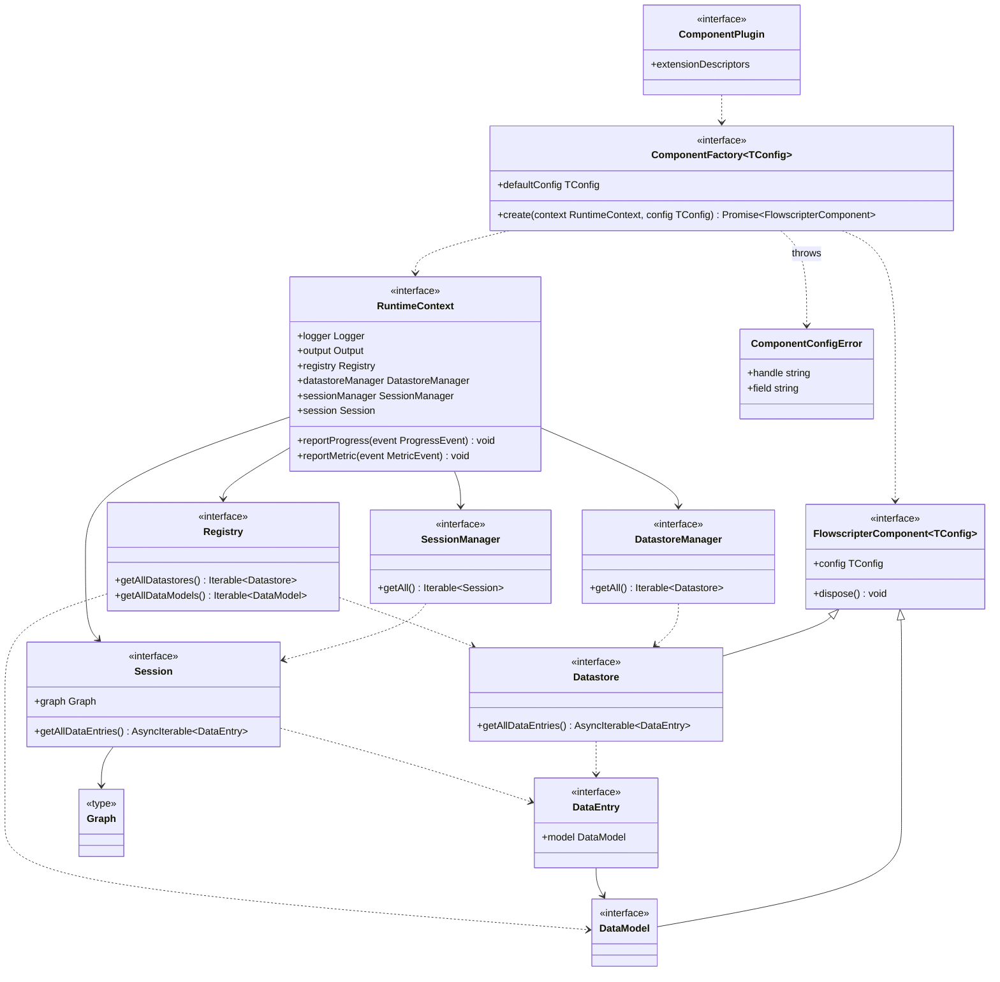

# plugin-api

[](https://github.com/flowscripter/plugin-api/releases)
[](https://github.com/flowscripter/plugin-api/actions/workflows/release-bun-library.yml)
[](https://codecov.io/gh/flowscripter/plugin-api)
[](https://flowscripter.github.io/plugin-api/index.html)
[](https://github.com/flowscripter/plugin-api/blob/main/LICENSE)

> Flowscripter plugin API: interfaces for command and component plugins

> Work in progress.

## Bun Module Usage

Add the module:

`bun add @flowscripter/plugin-api`

Use the module:

```typescript
import {
  ComponentConfigError,
  createComponentPlugin,
  type ComponentFactory,
  type Datastore,
} from "@flowscripter/plugin-api";

const datastoreFactory: ComponentFactory<{ path?: string }, Datastore> = {
  defaultConfig: {},
  create: async (context, config) => {
    if (config.path !== undefined && config.path === "") {
      throw new ComponentConfigError("path must not be empty", { field: "path" });
    }
    context.logger.info("creating datastore", { path: config.path ?? null });
    return {
      config,
      async *getAllDataEntries() {},
    };
  },
};

const plugin = createComponentPlugin({
  datastoreFactory,
  componentName: "Example Datastore",
  componentVersion: "1.0.0",
});
```

## Development

Install dependencies:

`bun install`

Build (produces `dist/` for Node.js and TypeScript consumers; Bun uses raw source directly):

`bun run build`

Test:

`bun test`

Format:

`bunx oxfmt`

Lint:

`bunx oxlint index.ts src/ tests/`

Generate HTML API Documentation:

`bunx typedoc index.ts`

## Documentation

### Overview

A component plugin provides factories for data models and datastores. The runtime calls each factory with a `RuntimeContext`, which gives components logging, output, progress and metric reporting, and access to the registry, datastore manager, session manager and the active session. A `Session` holds the processing `Graph` and exposes its data entries.



### API

Link to auto-generated API docs:

[API Documentation](https://flowscripter.github.io/plugin-api/index.html)

## License

MIT © Flowscripter
