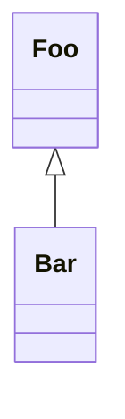

# plugin-api

[](https://github.com/flowscripter/plugin-api/releases)
[](https://github.com/flowscripter/plugin-api/actions/workflows/release-bun-library.yml)
[](https://codecov.io/gh/flowscripter/plugin-api)
[](https://flowscripter.github.io/plugin-api/index.html)
[](https://github.com/flowscripter/plugin-api/blob/main/LICENSE)

> Flowscripter plugin API: interfaces for command and component plugins

> Work in progress.

## Bun Module Usage

Add the module:

`bun add @flowscripter/plugin-api`

Use the module:

```typescript
import {
  createComponentPlugin,
  type ComponentFactory,
  type Datastore,
} from "@flowscripter/plugin-api";

const datastoreFactory: ComponentFactory<unknown, Datastore> = {
  create: async () => ({
    config: {},
    async *getAllDataEntries() {},
  }),
};

const plugin = createComponentPlugin({ datastoreFactory });
```

## Development

Install dependencies:

`bun install`

Build (produces `dist/` for Node.js and TypeScript consumers; Bun uses raw source directly):

`bun run build`

Test:

`bun test`

Format:

`bunx oxfmt`

Lint:

`bunx oxlint index.ts src/ tests/`

Generate HTML API Documentation:

`bunx typedoc index.ts`

## Documentation

### Overview

Sample mermaid diagram to test rendering in markdown:



### API

Link to auto-generated API docs:

[API Documentation](https://flowscripter.github.io/plugin-api/index.html)

## License

MIT © Flowscripter
